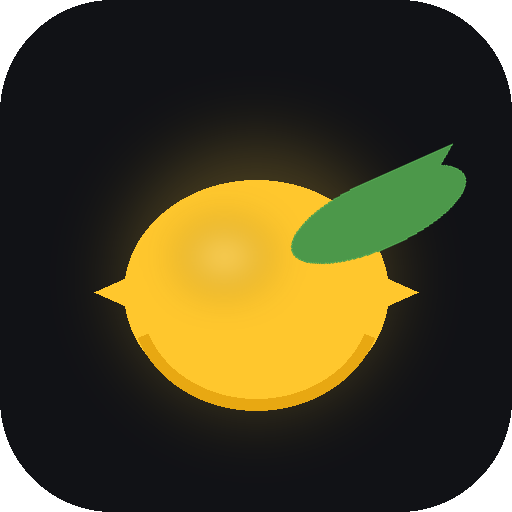
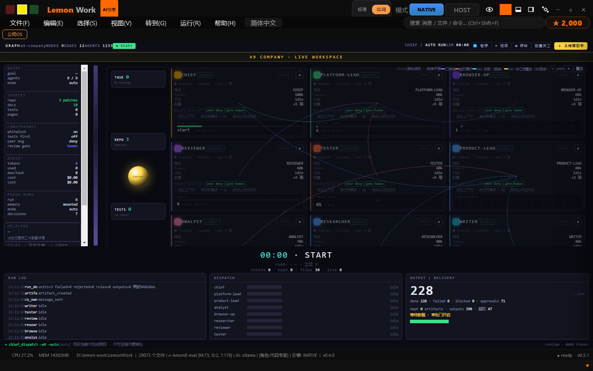
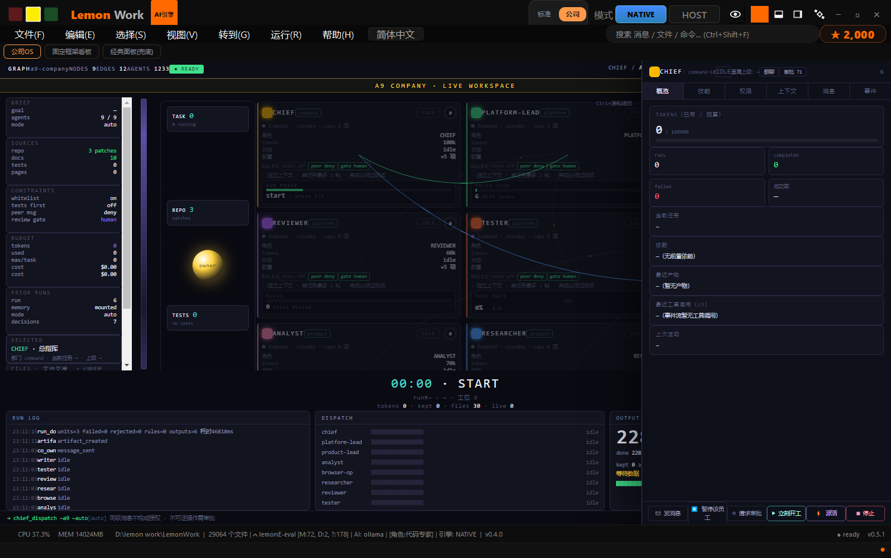
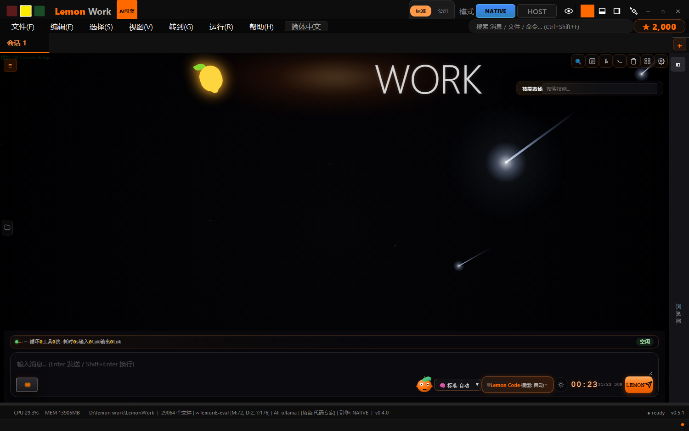
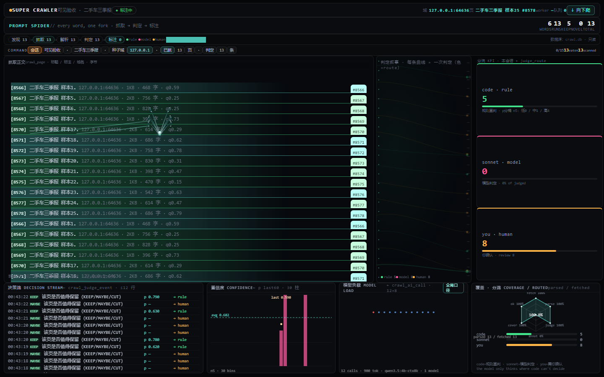

# 🍋 柠檬一人公司 · Lemon One

> **一个人的 AI 公司操作系统**
> 一句话，让 9 个 AI 员工组成你的公司：策划、调研、开发、评审到交付，全程可视、可审批、可追溯。
>
> **视频版本说明**：参赛视频是前身 **LemonCode** 的编码能力演示；本页和在线体验展示的是最新 **Lemon One 多 Agent 公司模式**。建议先看 9 工位 / 7 表账本 / 审批门，再回看视频作为标准模式补充。

<p align="center">
  
</p>

<p>
  
  
  
  
</p>

---

## 这是什么

Lemon One 是一个 Windows 桌面级 AI 工作台。它不是“一个会聊天的助手”，而是一家**可运行、可管理、可审计的 AI 公司**：

- **公司模式**：9 个角色 Agent 组成完整组织架构，有汇报关系、权限矩阵、技能白名单、token 预算、审批门和任务 DAG。
- **标准模式**：日常 AI 工作台，支持 DeepSeek / Ollama / 自定义 OpenAI 兼容端点，50+ 技能、文件产物、历史会话。
- **数字银行沙箱**：自然语言办理 36 项模拟银行业务，高风险操作必须人工审批，全程审计留痕。
- **多模态阅读**：PDF（含扫描件 OCR）、图片识图、视频字幕 / faster-whisper 本地语音转写。

> 数字银行为纯本地模拟沙箱，所有账户、资金、行情均为虚构数据，不涉及真实资金与真实金融机构。

---

## 为什么是 Lemon One，而不是普通 AI 助手

| 普通 AI 助手 | Lemon One |
|---|---|
| 一个聊天框 | **9 个有角色、权限、预算的 AI 员工** |
| 黑盒回答 | **七表账本 + 白盒过程，每个数字可追溯** |
| 一键全自动 | **不可逆操作必须人工审批，人保留最终控制权** |
| 单一模型 | **DeepSeek / Ollama / 自定义多引擎 + 文件/图片/视频阅读** |
| 跑完才说 | **实时看板、事件流、token / 吞吐 / 余额统计** |
| 演示稿 | **可运行的 Windows 桌面客户端** |

### 三个最硬的特色

1. **组织级 Agent，不是 9 个 prompt**
   9 个工位有汇报关系、权限矩阵、技能白名单、token 预算和审批门；每个员工都能独立配置模型、查看上下文、停止/重派。

2. **过程可审计，不是黑盒**
   任务 DAG、消息、工具调用、审批、越权拦截全部写入七表账本；前端白盒抽屉可以逐层展开，失败原因和拒绝理由都留在事件流里。

3. **人机边界清晰，不是失控自动化**
   资金类、不可逆操作必须人工审批；同级消息不构成授权；拒绝会明确取消，允许会留下审计记录。

---

## 为什么叫“一人公司”

传统 AI 助手只解决“回答问题”，但真实工作是一连串**有角色、有权限、有交付物**的协作。

Lemon One 把一家公司最小化到一个人 + 9 个 AI 员工：

| 角色 | 职责 |
|---|---|
| CHIEF | 拆解目标、分派任务、收束轮次 |
| PLANNER | 生成执行方案与任务 DAG |
| RESEARCHER | 检索、阅读、整理资料 |
| BUILDER | 编码、生成文件、运行测试 |
| REVIEWER | 评审产物、把关质量 |
| TESTER | 验证结果、回归检查 |
| WRITER | 输出方案、文档、汇报 |
| OPS | 运营、流程与交付支持 |
| AUDITOR | 权限审计、越权拦截、合规检查 |

公司级有账本和审批，员工级有独立模型、预算、技能和上下文。**一个人，也能拥有一家完整的 AI 公司。**

---

## 核心能力

### 1. 公司模式：组织、权限、预算、审批

- 9 工位员工卡：状态、当前任务、token 环、技能/权限/上下文白盒。
- 任务 DAG：CHIEF 拆解 → 计划审批 → 执行 → 评审 → 收束。
- 七表账本：`company_run / agent / task / event / approval / artifact / session`。
- 审批门：计划、配置、产物、不可逆操作分级审批。
- 越权拦截：同级消息不构成授权，审计留痕。

### 2. 实时看板与白盒过程

- 左栏 KPI：BRIEF、SOURCES、CONSTRAINTS、BUDGET、PRIOR RUNS、FILES、SESSIONS。
- 中间员工图：部门分组、汇报连线、任务/消息/产物联动。
- 底部三区：RUN LOG（事件流）、DISPATCH（派活进度）、OUTPUT / DELIVERY（交付统计）。
- 员工白盒抽屉：概览、技能、权限、上下文、消息、产出、事件。

### 3. 管理与上下文

- **实时计划**：任务列表、状态筛选、员工搜索、token / 耗时 / 结果。
- **历史会话**：全量会话台账、搜索、类型筛选、点击打开。
- **公司上下文**：跨轮次共享，owner 可编辑，真实注入子代理 DoD。
- **项目 / 公司**：多轮次项目列表、搜索、状态筛选、一键切换。
- **配置员工**：全局/每员工模型、API、token 预算，保存即生效。

### 4. 真实统计，不造数

- token 已用 / 预算 / 总量。
- 信息吞吐：近 60 秒 token/s、事件/分、收束/分、活跃员工。
- 引擎 / 模型 / 上下文预算。
- API 余额：DeepSeek 余额接口真实查询（后台线程 + 缓存，不暴露 Key）。
- 成本估算：按公开单价估算，并明确标注“仅参考”。

### 5. 多引擎与多模态

- DeepSeek 云端、Ollama 本地、任意 OpenAI 兼容自定义端点。
- PDF 文本 + 扫描件 OCR（PyMuPDF + 本地视觉模型）。
- 图片识图、截图问答。
- 视频字幕优先，无字幕时 faster-whisper 本地转写。
- 技能市场 50+，按角色白名单裁剪，避免工具越权。

---

## 真实运行截图

| 公司模式 · 9 工位 | 员工白盒抽屉 |
|---|---|
|  |  |

| 标准模式 · AI 工作台 | 超级爬虫 · 实时舞台 |
|---|---|
|  |  |

---

## 架构

```text
yh_main.py                         启动壳（Qt 环境 / 银行守护 / 主窗口）
└─ standard_mode/
   ├─ main.py                      QtWebEngine 主窗口
   ├─ ui/mimo_page.html            标准模式前端
   ├─ ui/hybrid_mode_web_panel.py  公司模式 Web 容器 + QWebChannel
   ├─ ui/main_window.py            模式栈 / 会话工作区 / 终端
   └─ core/vision_client.py        本地视觉模型客户端
└─ company_os.html                公司模式单页（组织图 / 看板 / 管理面板）
└─ hybrid_mode/core/
   └─ hybrid_mode_bridge.py        companyApi 统一动作位 / 上传 / 余额 / 白盒
└─ shared/company/
   ├─ service.py                   公司服务（run / task / approval / session）
   ├─ store.py                     七表 SQLite 账本
   └─ bus.py                       session_mesh 消息总线 + ACL
└─ shared/engine_manager.py        多引擎路由 / 子代理 / 视觉预处理
└─ shared/role_system.py           9 工位角色 / 权限矩阵 / 技能白名单
└─ session_mesh/                   会话与消息持久化
```

### 数据流

```text
用户上传 brief
  → CompanyService.upload_brief
  → 账本 artifact(brief)
  → CHIEF 拆解任务 DAG
  → 计划审批（manager / owner）
  → assign() 真实 spawn_subagent
  → 引擎执行 + 工具调用
  → 完成监视链回写 task / artifact / event
  → _notify_state() 推送完整快照
  → company_os.html 局部重绘
```

---

## 快速开始（源码运行）

```bash
git clone https://github.com/EVEN83-dev/lemon-work.git
cd lemon-work
pip install -r requirements.txt
python yh_main.py
```

启动后默认进入**标准模式**，点顶部「公司」胶囊进入公司模式。

模型配置：

- 不填 API Key：使用本地 Ollama（默认 `qwen3.5:4b`）。
- 使用云端：在「配置」中填入 DeepSeek Key，或添加任意 OpenAI 兼容端点。

> 本参赛包另附 `core-source.zip`（1.44MB / 135 个文件），包含公司模式、桥接、账本、角色系统、媒体技能等核心源码，便于评委离线审阅。
> 完整可运行整包（含虚拟银行、启动脚本、4 张截图、技术文档）：`LemonOne-参赛包-2026.zip`。

---

## 本轮 TRAE 开发增量

本项目历史由多种 AI 工具协作完成；**本轮参赛增量在 TRAE 中真实完成**：

1. 定位并修复公司页“一直是演示态”的两个根因：
   - 页面缺 `qwebchannel.js`；
   - `companyApi` 的 Qt 槽未声明参数，带参调用恒返回空串。
2. 公司页响应式布局：3/2/1 列、resize 重绘、顶栏横向滚动、底栏独立滚动、阶段条保留。
3. 新增实时计划 / 历史会话 / 公司上下文 / 项目四个管理面板。
4. 补齐真实统计：token 总量、近 60 秒吞吐、事件/分、API 余额、上下文预算。
5. 配置抽屉：9 名员工模型 / API / 预算保存。
6. 真实策划书上传：md / txt / pdf / docx 文本提取。
7. 实机验证：公司页 `real=true`、9 张员工卡、重载后 JS 异常 0。

---

## 诚实的边界

- 作品目前是**可运行的 Windows 桌面客户端**，未做公网 SaaS 上线。
- 数字银行为本地模拟沙箱，不涉及真实资金。
- 历史会话台账保留完整，但部分旧会话的消息正文可能已被消息库清理；界面会如实提示，不编造内容。
- 实时计划面板当前展示当前轮次最近 40 条任务快照；全量任务接口已存在，后续可切换为全量视图。
- 成本数字为按公开单价的估算，实际以 API 账单为准。
- AI 生成内容仍需人工审批与复核，尤其是资金类、不可逆操作。

---

## 仓库结构（参赛包）

```text
submission-2026/
├─ README.md                本文件
├─ FORM_ANSWERS.md          TRAE 好应用大赛字段 9-21 可复制答案
├─ JUDGE_GUIDE.md           评委体验指南（环境 / 步骤 / 检查点）
├─ DEMO_SCRIPT.md           3-5 分钟演示视频分镜
├─ PROJECT_OVERVIEW.md      产品与技术总览
├─ CHECKLIST.md             提交前人工检查清单
├─ core-source.zip          核心源码包（离线审阅）
├─ LemonOne-参赛包-2026.zip  完整可运行整包（虚拟银行 + 截图 + 文档 + 启动脚本）
├─ highlights/              本轮核心改动源码（可直接浏览）
└─ screenshots/             真实运行截图
```

---

## License

MIT。数字银行沙箱与所有演示数据仅用于能力验证与赛事演示。
